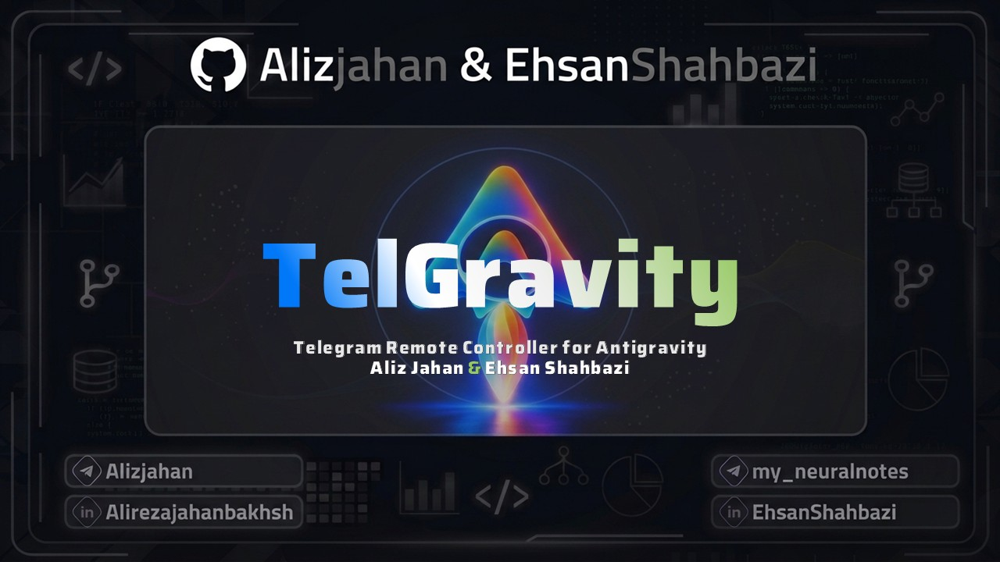
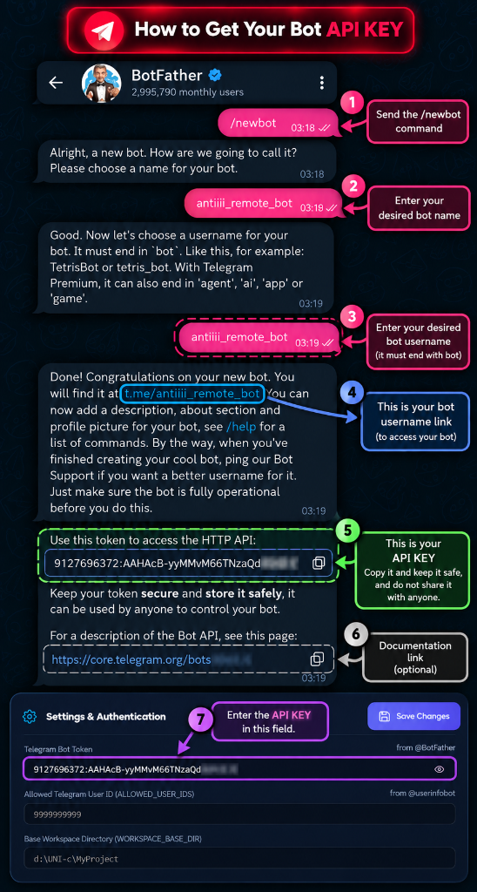
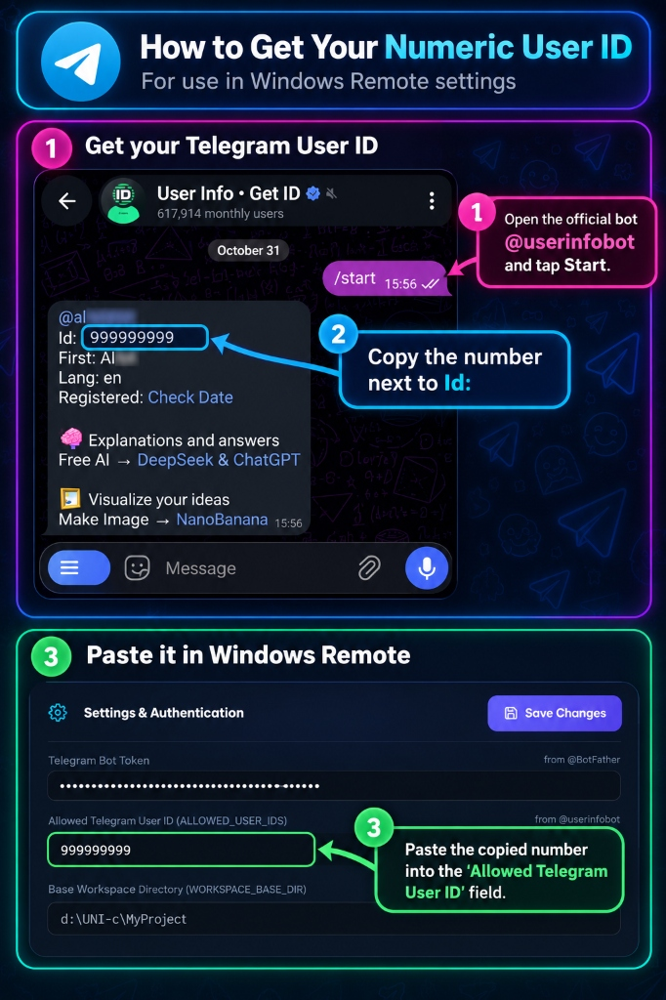

<p align="center">
  
</p>

<div align="center">

# TelGravity (Telegram Remote Controller for Antigravity)
### Intelligent Remote Bridge & Mission Control for Google Antigravity via Telegram

[](https://github.com/Alizjahan/TelGravity)
[](https://opensource.org/licenses/MIT)
[](https://nodejs.org/)
[]()
[](https://github.com/Alizjahan)

Control, monitor, prompt, and interact with your **Google Antigravity** AI assistant seamlessly from your smartphone or desktop via Telegram. Features live window screenshots, voice prompt execution, task aborting, and automated native project discovery.

[English Documentation](#overview) | [راهنمای فارسی](./README_FA.md)

</div>

---

> [!NOTE]
> **Zero-Configuration Native Discovery:**  
> TelGravity automatically queries your local Antigravity environment to list and switch between all active workspaces and conversations. No manual directory path configuration or moving project folders is required!

---

## Overview

**TelGravity** is a modern, high-performance remote control bridge designed exclusively for the **Google Antigravity** assistant. Powered by Chrome DevTools Protocol (CDP) and native React Fiber navigation, TelGravity transforms Telegram into an interactive handheld cockpit for your AI coding sessions.

Whether you are away from your workstation, commuting, or simply monitoring long-running agent workflows from your bed, TelGravity keeps you in complete command of your coding workflows.

---

## ✨ Features

- **🚀 Two-Way Conversational Control**:
  - Send prompts directly into active Antigravity conversations.
  - Automatically receive formatted Markdown/HTML responses as soon as the assistant finishes generating.
- **📸 Instant Live Window Screenshots**:
  - Dispatch `/screenshot` to receive high-definition, real-time screenshots of your Antigravity IDE directly in chat.
- **🎙️ Voice Message Prompting**:
  - Send voice notes directly from your phone — TelGravity automatically downloads, processes, and submits them to the active model.
- **📂 Native Project & Session Switcher**:
  - Switch between projects and conversations via inline keyboard buttons or start fresh conversations with `/new` (General standalone mode or project-specific).
- **⏹️ Instant Abort / Task Stop**:
  - One-tap `/stop` button terminates lingering tool executions, cancels pending chat queues, or aborts runaway tasks immediately.
- **🖥️ Beautiful Web Dashboard**:
  - Built-in local management UI (`http://127.0.0.1:3888`) with live console telemetry, service controls, and one-click token configuration.
- **🔒 Enterprise-Grade Security**:
  - Strict user ID whitelisting (`ALLOWED_USER_IDS`) blocks unauthorized access.
  - Process locking (`.bot.lock`) prevents multiple rogue instances.
- **🌐 Bilingual Support (English & Persian)**:
  - Toggle between Persian and English using `/lang` or via the web dashboard. All notifications, buttons, and help guides render in your preferred language.

---

## 🚀 Step-by-Step Setup & Management Guide

TelGravity comes with an interactive graphical Web Dashboard (`http://127.0.0.1:3888`) designed for rapid zero-friction setup in 5 simple steps:

### Step 0: Initial System Prerequisites

Before connecting and launching the bot, make sure to initialize and install the two essential prerequisites:

1. **Prerequisite 1: Install Dependencies (`npm install`)**:
   ```bash
   npm install
   npm run build
   ```
2. **Prerequisite 2: Telegram RTL Formatting Skill (`persian-rtl-formatter`)**:
   - TelGravity includes the `persian-rtl-formatter` skill in `skills/persian-rtl-formatter`.
   - You can click **"Prerequisite 2: Install Telegram RTL Skill"** on the Web Dashboard to copy it into Antigravity's global skills catalog.
   - **Alternative quick prompt (No installation required)**:  
     If you prefer not to install the skill, simply send this prompt at the beginning of your chat session with Antigravity:
     > *"Telegram RTL Rule: In all Persian or bilingual outputs, always start every line and bullet point with a Persian word or phrasing (e.g. instead of '• Bold: text', write '• حالت Bold: text'). Avoid starting lines with English words or parentheses so that Telegram maintains clean RTL alignment."*

---

### Step 1: Get Dedicated Bot Token from @BotFather

1. Open the official [@BotFather](https://t.me/BotFather) in Telegram.
2. Send the command `/newbot`.
3. Choose a friendly display name (e.g. `Antigravity Remote`) and an English username ending in `bot` (e.g. `my_antigravity_bot`).
4. Copy the API Token given to you (e.g. `123456789:ABCdefGhI...`) into the **Telegram Bot Token** field in the Web Dashboard or `.env` file.

<p align="center">
  
</p>

---

### Step 2: Get Numeric Telegram ID from @userinfobot

For the security of your computer and code, the bot only responds to your verified Telegram account; unauthorized users are automatically blocked.

1. Open the official [@userinfobot](https://t.me/userinfobot) and press `/start`.
2. Copy the numeric digits next to **Id:** (e.g. `999999999`).
3. Paste into **Allowed Telegram User ID** (`ALLOWED_USER_IDS`) in the dashboard or `.env`.

<p align="center">
  
</p>

---

### Step 3: Smart Auto-Discovery of Projects

No manual directory configuration needed! TelGravity automatically discovers all your active projects and conversations directly from the Antigravity runtime environment (`~/.gemini/antigravity`).

---

### Step 4: Save, Start Service & Test in Telegram

1. Click **"Save Changes"** in the Web Dashboard.
2. Click **"Start Bot Service"** until the status badge turns **Online & Ready**.
3. Open Telegram and send `/start` to your bot!

```bash
# Launch the graphical Web Dashboard at http://127.0.0.1:3888
npm run ui

# Or run headless daemon mode in the background
npm run start:built
```

---

### Step 5: Automated File Archiving (`Archie file Send&Receive/`)

TelGravity automatically routes, organizes, and archives all inbound and outbound media without data loss:

- **`Receive/` (Inbound):** Files sent by you to the bot / Antigravity from Telegram.
- **`Send/` (Outbound):** Files sent by the bot / Antigravity to you on Telegram.

```
Archie file Send&Receive/
├── Receive/               # Inbound files from user to bot
│   ├── Images/            # Photos, bug screenshots & visual assets
│   ├── Voices/            # Voice notes and audio recordings
│   ├── PDF/               # Books, papers & reference documents
│   └── Documents/         # Code files, configs & attachments
└── Send/                  # Outbound files from bot to Telegram
    ├── Screenshots/       # Live window screenshots captured from Antigravity
    ├── Images/            # AI-generated charts, diagrams & pictures
    ├── PDF/               # Exported reports & documentation
    └── Documents/         # Generated code, log files & deliverables
```

---

## 🤖 Telegram Commands Reference

| Command | Description |
| :--- | :--- |
| **`/start`** | Open the main interactive glass control menu & telemetry status |
| **`/help`** | Display the comprehensive multi-lingual command reference & usage guide |
| **`/new`** | Launch a brand new chat session (General mode or Project-specific) |
| **`/project`** | Browse all recognized Antigravity projects and switch conversations |
| **`/status`** | Inspect active running tasks, connected CDP port, and system health |
| **`/screenshot`** | Capture and send a crisp, live screenshot of the Antigravity window |
| **`/stop`** | Abort stuck tool executions, active generation, or background loops |
| **`/last`** | Retrieve the latest completed assistant output from transcript history |
| **`/lang`** | Toggle bot language instantly between Persian (`fa`) and English (`en`) |
| **`/about`** | View developer credits, contributors, and GitHub repository links |
| **`/ping`** | Measure real-time server latency and Telegram API round-trip delay |

---

## 🏗️ Architecture & How It Works

```
┌─────────────────┐       Telegram Bot API       ┌───────────────────────────┐
│  Telegram App   │ ◄──────────────────────────► │    TelGravity Service     │
│ (Phone/Desktop) │                              │     (Node.js / grammY)    │
│                 │                              │ Web Dashboard (Port 3888) │
└─────────────────┘                              └─────────────┬─────────────┘
                                                               │
                                                   Chrome DevTools Protocol
                                                   (CDP WebSocket & Fiber)
                                                               │
                                                 ┌─────────────▼─────────────┐
                                                 │   Google Antigravity IDE  │
                                                 │   (Electron / React Fiber)│
                                                 └───────────────────────────┘
```

1. **Chrome DevTools Protocol (CDP)**: Interacts directly with the running Antigravity Electron process over its active remote debugging port, enabling click dispatches, input text injections, and live viewport captures.
2. **React Fiber Navigation**: Navigates the internal TanStack router directly through React container fibers for instant, 100% reliable session switching without fragile DOM clicking.
3. **SQLite Summaries Sync**: Automatically monitors `~/.gemini/antigravity/conversation_summaries.db` for instant project extraction and metadata synchronization.

---

## 👨‍💻 Developers & Maintainers

Developed with ❤️ by:
- **Aliz ([@Alizjahan](https://github.com/Alizjahan))**
  - GitHub: [@Alizjahan](https://github.com/Alizjahan)
  - Telegram: [@Alizjahan](https://t.me/Alizjahan)
- **Ehsan Shahbazi ([@EhsanShahbazii](https://github.com/EhsanShahbazii))**
  - GitHub: [@EhsanShahbazii](https://github.com/EhsanShahbazii)

---

## 📄 License

This project is open-sourced under the [MIT License](LICENSE).
