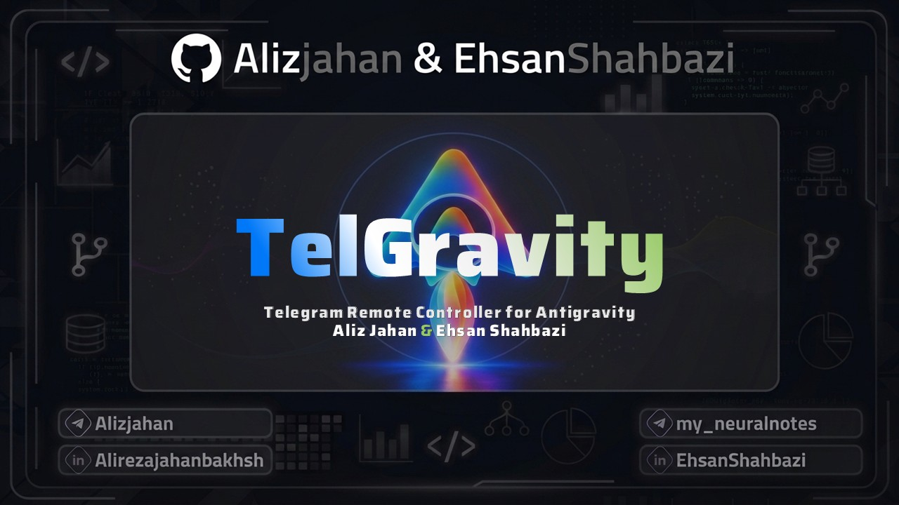
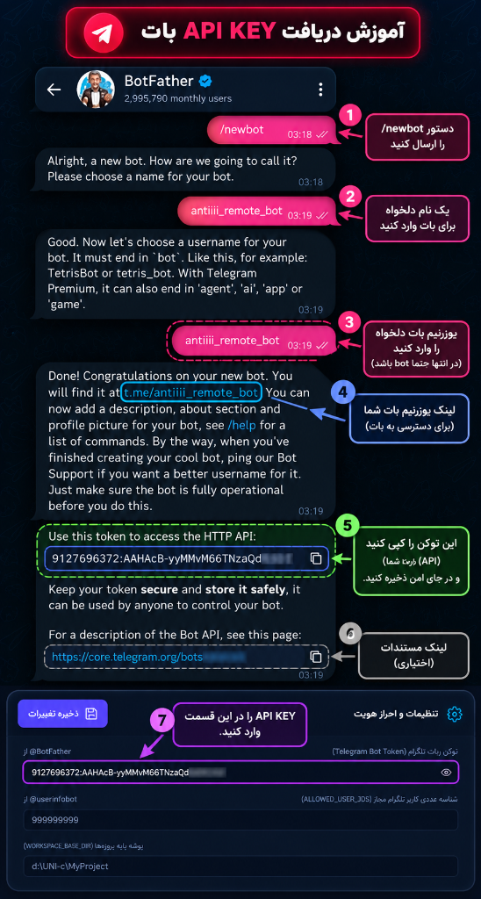
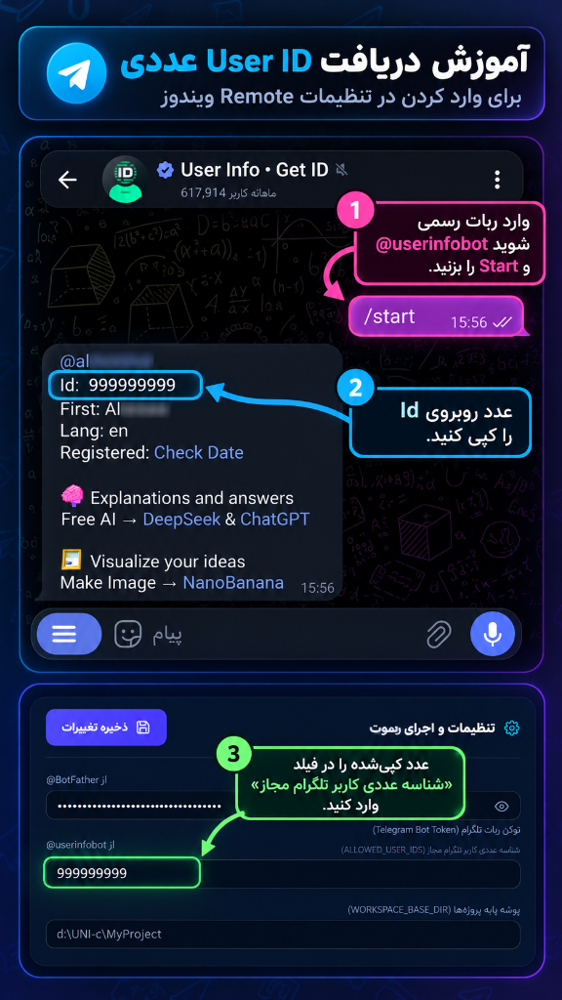

<p align="center">
  
</p>

<div align="center">

# نرم‌افزار TelGravity (Telegram Remote Controller for Antigravity)
### پل ارتباطی هوشمند و مرکز کنترل راه دور دستیار Google Antigravity از طریق تلگرام

[](https://github.com/Alizjahan/TelGravity)
[](https://opensource.org/licenses/MIT)
[](https://nodejs.org/)
[]()
[](https://github.com/Alizjahan)

دستیار هوش مصنوعی **Google Antigravity** را به آسانی از طریق تلگرام روی گوشی یا کامپیوتر کنترل، نظارت و هدایت کنید. مجهز به اسکرین‌شات زنده، اجرای فرامین صوتی، لغو آنی تسک‌ها و کشف خودکار پروژه‌ها بدون نیاز به تنظیم مسیر.

[English Documentation](./README.md) | [راهنمای فارسی](#معرفی-پروژه)

</div>

---

> [!NOTE]
> **قابلیت کشف کاملاً بومی و خودکار پروژه‌ها:**  
> سیستم TelGravity با اتصال مستقیم به محیط Antigravity، تمام پروژه‌ها و گفتگوهای فعال شما را خودکار شناسایی می‌کند. به هیچ‌گونه آدرس‌دهی دستی یا جابجایی پوشه‌های کاری نیازی نخواهید داشت!

---

## معرفی پروژه

نرم‌افزار **TelGravity** یک پل ارتباطی مدرن و بسیار سریع برای کنترل از راه دور دستیار هوشمند **Google Antigravity** است. این ابزار به کمک پروتکل اختصاصی Chrome DevTools Protocol (CDP) و تعامل مستقیم با React Fiber، تلگرام شما را به یک پنل فرماندهی زنده برای هدایت مدل‌های هوش مصنوعی کدنویسی تبدیل می‌کند.

چه دور از سیستم باشید و چه بخواهید فرآیندهای طولانی را بررسی کنید، TelGravity امکان دسترسی لحظه‌ای و کنترل پایدار را به شما می‌دهد.

---

## ✨ امکانات و قابلیت‌های برجسته

- **🚀 هدایت دوطرفه و گفتگو در لحظه**:
  - ارسال پرامپت‌ها و درخواست‌های متنی مستقیم به پنجره فعال Antigravity.
  - دریافت خودکار خروجی هوش مصنوعی بلافاصله پس از تکمیل تولید متن یا کد.
- **📸 دریافت فوری اسکرین‌شات زنده (`/screenshot`)**:
  - دریافت عکس شفاف و دقیق از محیط برنامه Antigravity به طور لحظه‌ای در تلگرام.
- **🎙️ ارسال دستورات با پیام صوتی (Voice)**:
  - ضبط و ارسال صدا از طریق گوشی جهت اجرای فرامین بدون نیاز به تایپ دستی.
- **📂 سوییچ هوشمند بین پروژه‌ها و چت‌ها (`/project` و `/new`)**:
  - جابجایی بین گفتگوها و آغاز نشست‌های گفتگوی تازه (چه عمومی و چه مختص یک پروژه مشخص).
- **⏹️ لغو و متوقف‌سازی سریع فرآیندها (`/stop`)**:
  - دکمه لغو آنی برای متوقف کردن کارهای در حال پردازش یا حلقه‌های طولانی مدل.
- **🖥️ پنل وب گرافیکی و بومی (داشبورد مدیریتی)**:
  - محیط کاربری زیبا تحت آدرس `http://127.0.0.1:3888` با نمایش لاگ‌های زنده کنسول، دکمه‌های کنترل سرویس و ورود آسان توکن.
- **🔒 امنیت سطح بالا با لیست سفید کاربران**:
  - بررسی و احراز هویت دقیق شناسه کاربری (`ALLOWED_USER_IDS`) جهت مسدودسازی کامل دسترسی‌های متفرقه.
- **🌐 پشتیبانی روان از زبان فارسی و انگلیسی**:
  - سوئیچ سریع زبان کاری با دستور `/lang` یا از طریق داشبورد وب همراه با چیدمان اصولی راست‌به‌چپ.

---

## 🚀 راهنمای گام‌به‌گام راه‌اندازی و استفاده (۵ مرحله ساده)

برنامه TelGravity همراه با یک پنل گرافیکی وب (`http://127.0.0.1:3888`) عرضه شده است تا فرآیند اتصال در ۵ گام فوق‌العاده ساده طی شود:

### مرحله صفرم: نصب پیش‌نیازهای اولیه سیستم

پیش از اتصال و راه‌اندازی ربات، حتماً دو پیش‌نیاز زیر را یک‌بار راه‌اندازی و نصب نمایید:

۱. **پیش‌نیاز اول: نصب پکیج‌ها و کتابخانه‌ها (`npm install`)**:
   ```bash
   npm install
   npm run build
   ```
۲. **پیش‌نیاز دوم: اسکیل راست‌چین پیام‌های تلگرام (`persian-rtl-formatter`)**:
   - پوشه مهارت در مسیر `skills/persian-rtl-formatter` قرار دارد.
   - می‌توانید در پنل وب داشبورد روی دکمه **«پیش‌نیاز دوم: نصب اسکیل»** کلیک کنید تا خودکار در مهارت‌های Antigravity رجیستر شود.
   - **روش سریع بدون نصب اسکیل**:  
     اگر تمایلی به نصب اسکیل ندارید، کافیست متن پرامپت زیر را همیشه در ابتدای پیام‌هایتان به Antigravity بفرستید:
     > *«قانون راست‌چین تلگرام: در تمامی خروجی‌های فارسی یا دوزبانه، تمام خطوط و بولت‌پوینت‌ها را حتماً با یک واژه یا عبارت فارسی آغاز کن (مثلاً به جای «• Bold: متن» بنویس «• حالت Bold: متن» یا «• ویژگی Bold: متن»). از شروع مستقیم خطوط با کلمات انگلیسی یا پرانتز خودداری کن تا خروجی در تلگرام کاملاً راست‌چین و منظم باشد.»*

---

### مرحله اول: دریافت توکن اختصاصی ربات از BotFather

۱. وارد ربات رسمی [@BotFather](https://t.me/BotFather) در تلگرام شوید.  
۲. دستور `/newbot` را ارسال نمایید.  
۳. ابتدا یک نام دلخواه برای ربات (مانند `Antigravity Remote`) و سپس یک یوزرنیم انگلیسی که به `bot` ختم شود (مانند `my_antigravity_bot`) تعیین کنید.  
۴. کدی که دریافت می‌کنید (مانند `123456789:ABCdefGhI...`) همان توکن ربات است؛ آن را در داشبورد وب یا فایل `.env` قرار دهید.

<p align="center">
  
</p>

---

### مرحله دوم: دریافت شناسه عددی تلگرام (Allowed User ID)

جهت حفظ کامل امنیت سیستم، ربات تنها به اکانت تلگرام شما پاسخ می‌دهد و دسترسی افراد دیگر کاملاً مسدود خواهد بود:

۱. وارد ربات رسمی [@userinfobot](https://t.me/userinfobot) شوید و دکمه Start را بزنید.  
۲. عدد چندرقمی روبروی عبارت **Id:** (مثلاً `999999999`) را کپی کنید.  
۳. مقدار کپی‌شده را در فیلد **شناسه عددی کاربر تلگرام مجاز** (`ALLOWED_USER_IDS`) وارد نمایید.

<p align="center">
  
</p>

---

### مرحله سوم: کشف کاملاً خودکار پروژه‌ها و گفتگوها

نیازی به وارد کردن دستی آدرس پوشه پروژه‌ها نیست! نرم‌افزار به صورت خودکار تمام پروژه‌ها و گفتگوهای فعال شما را مستقیماً از داخل محیط Antigravity استخراج کرده و دسته‌بندی می‌نماید.

---

### مرحله چهارم: ذخیره، شروع سرویس و تست در تلگرام

۱. روی دکمه سبز **«ذخیره تغییرات»** در داشبورد کلیک کنید.  
۲. دکمه آبی **«شروع سرویس ربات»** را بزنید تا وضعیت بالا به **آنلاین و آماده دریافت** تبدیل شود.  
۳. وارد تلگرام خود شوید و پیام `/start` را به ربات بفرستید!

```bash
# باز کردن داشبورد گرافیکی در مرورگر (http://127.0.0.1:3888)
npm run ui

# یا اجرای مستقیم و پس‌زمینه بدون پنل وب
npm run start:built
```

---

### مرحله پنجم: آرشیو و بایگانی هوشمند فایل‌ها (`Archie file Send&Receive/`)

تمامی فایل‌های رد و بدل شده به تفکیک نوع فایل به صورت کاملاً خودکار سازمان‌دهی و آرشیو می‌شوند:

- **پوشه `Receive/` (دریافتی‌ها):** فایل‌هایی که شما در تلگرام برای ربات و Antigravity ارسال می‌کنید.
- **پوشه `Send/` (ارسالی‌ها):** فایل‌هایی که دستیار Antigravity و ربات برای شما به تلگرام می‌فرستند.

```
Archie file Send&Receive/
├── Receive/               # فایل‌های ارسال‌شده از شما به ربات
│   ├── Images/            # عکس‌ها، اسکرین‌شات‌ها و تصاویر ارسالی
│   ├── Voices/            # ویس‌ها و پیام‌های صوتی ضبط‌شده شما
│   ├── PDF/               # کتاب‌ها، مقالات و فایل‌های پی‌دی‌اف
│   └── Documents/         # فایل‌های کد، اسناد متنی و ضمیمه‌ها
└── Send/                  # فایل‌های ارسال‌شده از ربات به تلگرام
    ├── Screenshots/       # اسکرین‌شات‌های زنده و مستقیم از صفحه
    ├── Images/            # تصاویر و چارت‌های تولیدشده توسط سیستم
    ├── PDF/               # گزارش‌ها و مستندات خروجی پی‌دی‌اف
    └── Documents/         # کدهای نهایی، لاگ‌ها و فایل‌های تحویلی
```

---

## 🤖 جدول مرجع دستورات ربات تلگرام

| دستور تلگرام | توضیحات و کارکرد |
| :--- | :--- |
| **`/start`** | باز کردن منوی شیشه‌ای کنترل، وضعیت اتصال و فهرست دسترسی |
| **`/help`** | نمایش راهنمای کامل و معرفی تمام دستورات و امکانات |
| **`/new`** | شروع گفتگوی تازه (به صورت عمومی یا درون یک پروژه خاص) |
| **`/project`** | مرور و انتخاب پروژه‌ها و جابجایی هوشمند بین گفتگوها |
| **`/status`** | بررسی تسک‌های فعال، سلامت اتصال و وضعیت پورت CDP |
| **`/screenshot`** | دریافت فوری اسکرین‌شات باکیفیت و زنده از پنجره برنامه Antigravity |
| **`/stop`** | توقف آنی پردازش جاری و لغو دستورات معلق مدل |
| **`/last`** | بازیابی و ارسال مجدد آخرین پاسخ دستیار از حافظه سیستم |
| **`/lang`** | تغییر آنی زبان کاری ربات میان فارسی و انگلیسی |
| **`/ping`** | آزمایش سرعت پاسخ‌دهی و تاخیر شبکه سرور |

---

## 👨‍💻 توسعه‌دهنده

توسعه‌یافته با ❤️ توسط **Aliz ([@Alizjahan](https://github.com/Alizjahan))**
- گیت‌هاب: [https://github.com/Alizjahan](https://github.com/Alizjahan)
- تلگرام: [https://t.me/Alizjahan](https://t.me/Alizjahan)

---

## 📄 مجوز انتشار

این نرم‌افزار به صورت منبع‌باز و تحت مجوز [MIT License](LICENSE) منتشر گردیده است.
